# Starlink Mini Battery Mount

A premium 3D printed stand mount for your Starlink Mini that cradles a USB power bank.

<table>
  <tr>
    <td>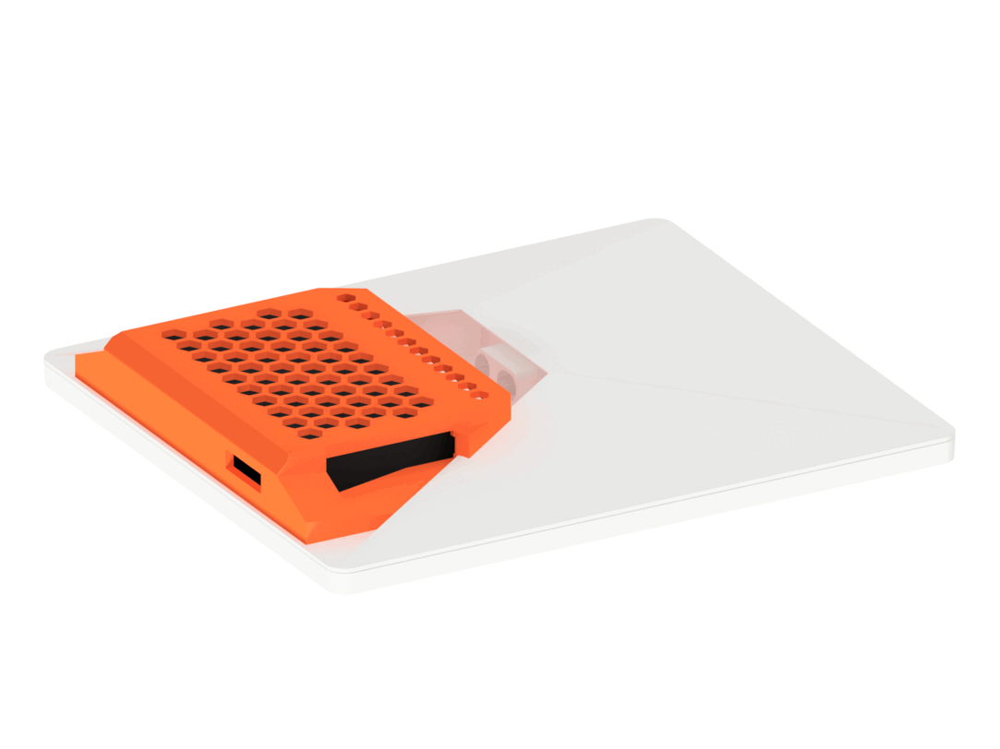</td>
    <td>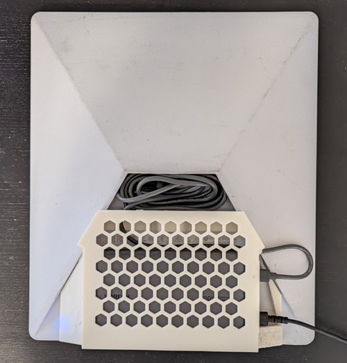</td>
  </tr>
</table>

## Features

- Factory fit stand and battery mount combo
- Hexagon venting across the visible panels for airflow
- Custom bay for a USB power bank / battery (see below)
- Access areas for the USB ports, LCD display, and power on/off button
- Locator tabs sized to the Mini's real kickstand slot (17.0 mm of its 19.3 mm
  length), rising straight out of a flush seat so they take handling loads
  without snapping
- Tuned for ASA (vehicle/outdoor) or PLA+ (desk/indoor) on a 0.4 mm nozzle; a
  fast PLA prototype profile is included for fit checks
- The mount is modeled in [CadQuery](https://cadquery.readthedocs.io/en/latest/)

Locator tab measurements, failure analysis and the print guidance for those tabs
are in [docs/locator-tabs.md](docs/locator-tabs.md).

## Repository layout

| Path | Contents |
| --- | --- |
| `cad/` | Parametric source, validators and download scripts. |
| `cad/design_parameters.json` | All tunable dimensions for the current revision. |
| `cad/out/` | Generated meshes, STEP files and validation reports (git-ignored). |
| `docs/official/` | Official Starlink Mini dish reference (STL + STEP). |
| `export/` | Published, ready-to-slice outputs (`.stl`, `.3mf`, `.f3d`). |

## Equipment

### Starlink Mini

Get a [Starlink Mini](https://starlink.com/) if don't already own it.

### USB cables

Search for "starlink mini usb c to barrel jack 3ft" or check out the links below:

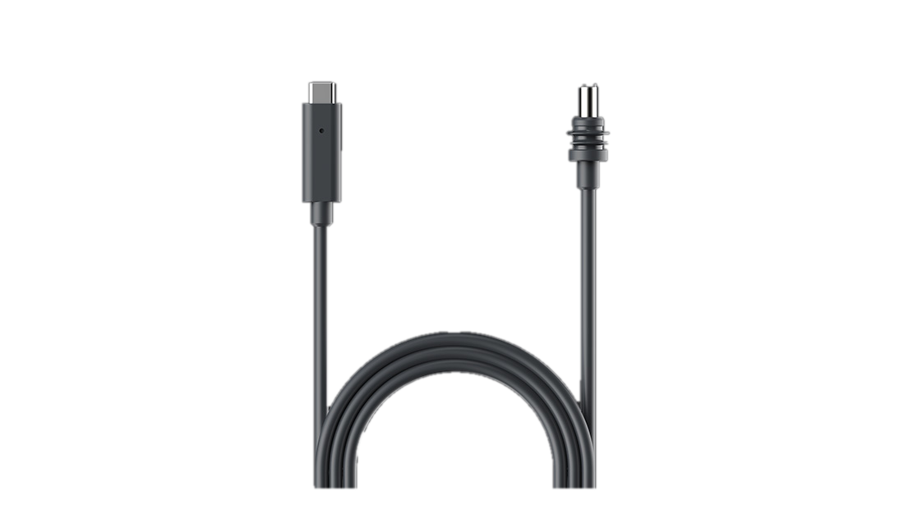

- https://starlink.com/shop/products/us-usbc-cable-mini
- https://www.amazon.com/dp/B0H491F83B
- https://www.amazon.com/dp/B0F62JD1Z4
- https://www.amazon.com/NEDUL-Starlink-Waterproof-Compatible-Protocol/dp/B0DFH5DSPL

### USB Power Bank

This mount is made specifically for this power bank:

[UGREEN Nexode 100W 20000mAh Power Bank](https://www.amazon.com/dp/B0C3GTMX5M)

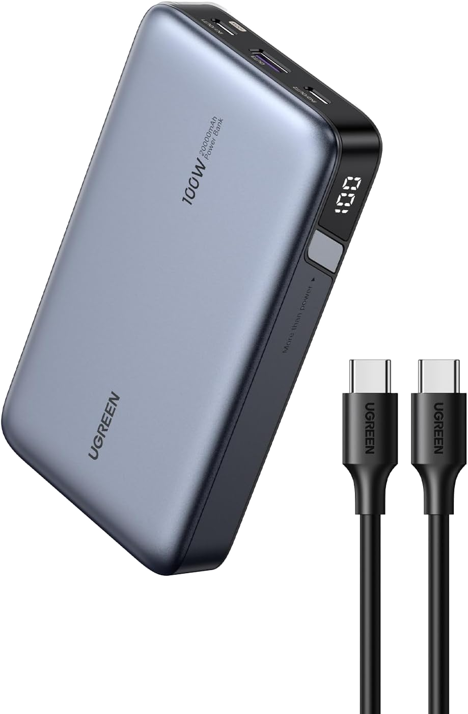

- Model name: PB720
- Model number: 25188
- Size: 139 x 80.8 x 26.7 mm
- Watt Hours: 72 Wh
- USB ports: 2 USB-C, 1 USB-A
- Passthrough charging: **YES**

The mount and battery are sized perfectly to fit behind the Mini and provide ample power to the unit (72Wh, ~3 hours average use). 

This unit was picked based balancing quality, size, cost, and capacity.

#### What if I want to use a different USB power bank?

This project is built to be extendable. Scripts are included that produce the model and a Autodesk Fusion 360 *.f3d file are provided. This should make it easier to get started contributing. Changes such as battery bay size or overall dimensions/geometry are possible. If you do make something new share your fork/remix!

## Renders & Images

<table>
  <tr>
    <td>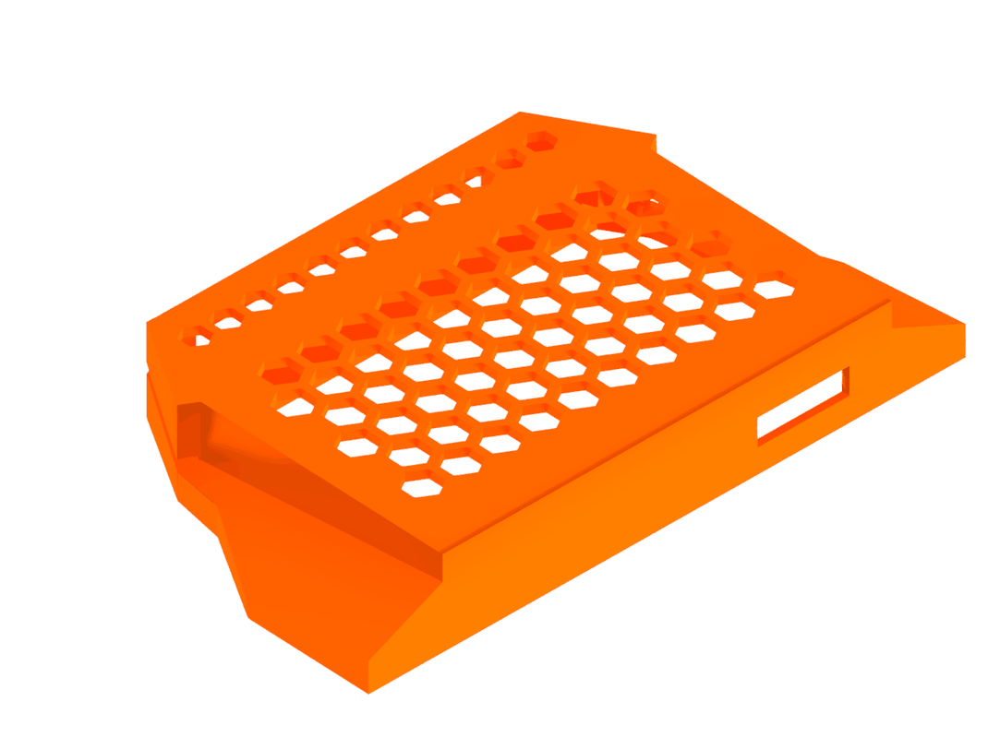</td>
    <td>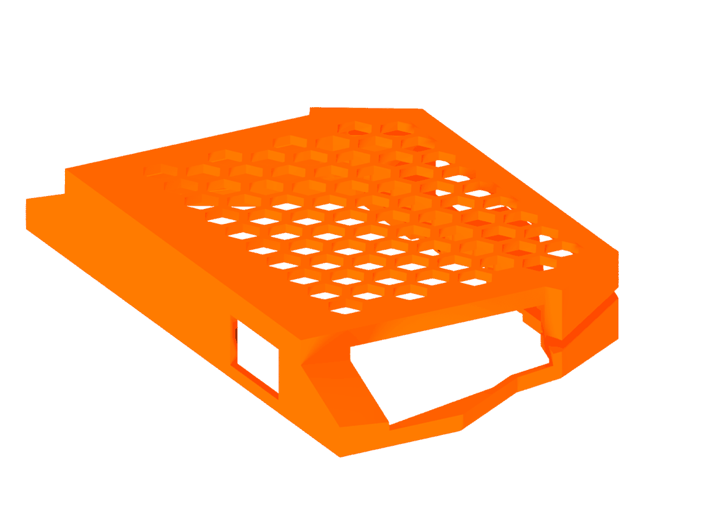</td>
    <td>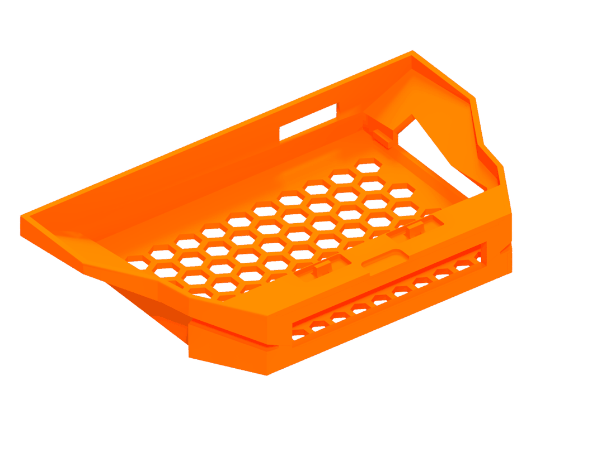</td>
  </tr>
  <tr>
    <td>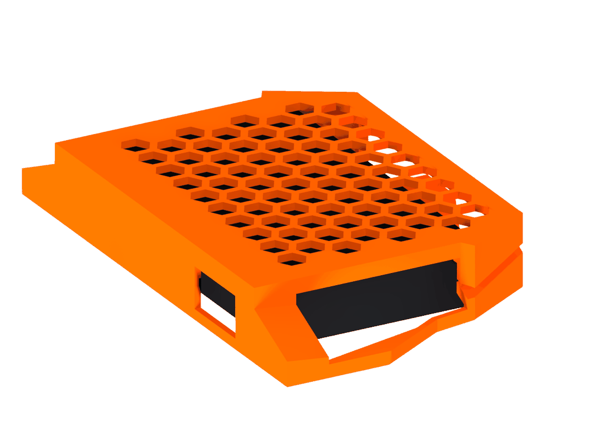</td>
    <td>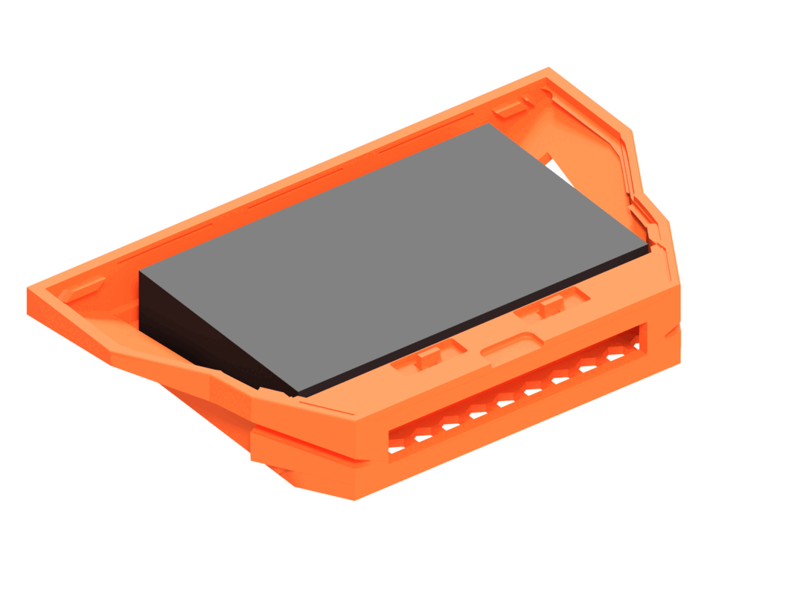</td>
    <td>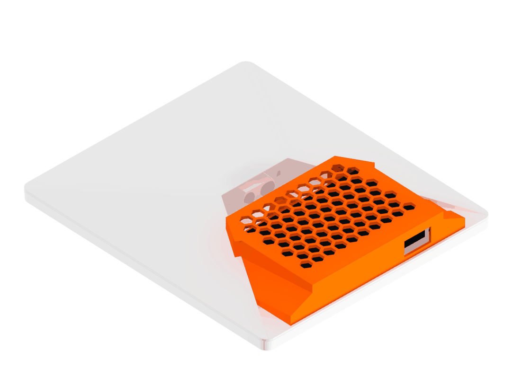</td>
  </tr>
  <tr>
    <td>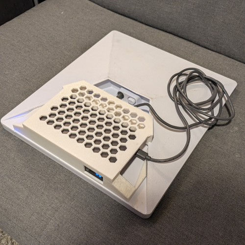</td>
    <td>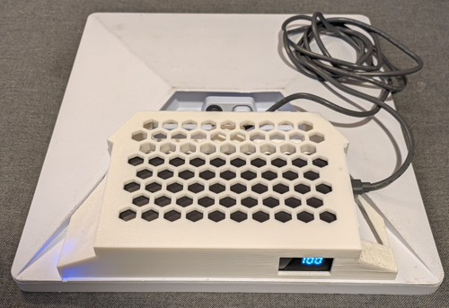</td>
    <td></td>
</tr>
</table>

## Print

- Ready-to-print files are in `export/`
- **Accompanying 3MF file is tuned for Bambu P1S**
- STL can be used with any slicer
- F3D can be used to export a STP/STEP file if needed

### Settings

| Name | Production ASA | Production PLA+ | Prototype PLA |
| --- | --- | --- | --- |
| Material | ELEGOO ASA | PLA+ | PLA |
| Nozzle | 0.4 mm | 0.4 mm | 0.4 mm |
| Layer / first layer height | 0.2 / 0.2 mm | 0.2 / 0.2 mm | 0.2 / 0.2 mm |
| Wall loops | 6 | 6 | 3 |
| Outer wall line width | 0.42 mm | 0.42 mm | 0.42 mm |
| Top / bottom shells | 6 / 6 | 6 / 6 | 3 / 3 |
| Sparse infill | 40% gyroid | 40% gyroid | 10% grid |
| Supports | Tree organic, 30° | Tree organic, 30° | Tree organic, 30° |
| Brim | Outer only, 10 mm | Outer only, 10 mm | Auto, 5 mm |
| Nozzle temperature | 265 °C | 225 °C | 220 °C |
| Bed temperature (Textured PEI) | 100 °C | 60 °C | 55 °C |
| Flow ratio | 0.97 | 0.99 | 0.98 |
| Max volumetric speed | 8 mm³/s | 14 mm³/s | 12 mm³/s |
| Fan min / max | 0% / 10% | 0% / 40% | 100% / 100% |
| Fan off first layers | 3 | 3 | 1 |
| Outer / inner / sparse speed | 40 / 80 / 90 mm/s | 60 / 100 / 120 mm/s | 80 / 160 / 180 mm/s |
| Seam position | Back | Back | Back |

The two locator tabs are the highest-stress feature on the part. They print as
vertical posts, so their strength depends on layer adhesion:

- Print at 0.2 mm layers or finer, with 6 walls, and do not thin or hollow the
  tab region.
- Keep the Z seam on the back of the mount, away from the tabs.
- **ASA:** use an enclosure at 45-50 °C, keep part cooling at or below 10%, and
  do not drop below 265 °C. ASA has the weakest layer bond of the common
  filaments, so this matters more than the strength of the filament itself.
- **PLA+:** bonds better between layers than ASA, but softens around 55-60 °C.
  Do not leave a PLA+ mount in a hot vehicle or direct summer sun; use ASA for
  vehicle/outdoor use.

### Material choice

| | ASA | PLA+ | PETG |
| --- | --- | --- | --- |
| Layer adhesion | weakest | good | good |
| Heat deflection | ~95 °C | ~55 °C | ~70 °C |
| UV / weather | excellent | poor | fair |
| Use | vehicle, outdoor | desk, indoor, backpack | middle ground |

## Regenerating the model

The source is Python. From the `cad/` directory:

```sh
python -m venv .venv
.venv/Scripts/activate        # Windows (use source .venv/bin/activate on Unix)
pip install -r requirements.txt
python generate_mount.py      # writes cad/out/mount_v19.stl (+ .step)
```

There is a single build script. Revisions are tracked by git, not by separate
`generate_mount_vN.py` files; the `revision` field in
`cad/design_parameters.json` only labels the generated artifacts.

`generate_mount.py --mesh-only` skips the STEP export for faster iteration.
Validation scripts in `cad/` (for example `validate_mount.py`) assert that the
generated solid stays watertight and matches the mated geometry.

### Required inputs outside version control

- `docs/example-mount/exterior.stl` and `docs/example-mount/interior.stl` — the
  supplied shell that defines the Mini mating rim. The build stops with an
  explicit message if they are absent.
- `cad/review/dish_step_precise_primary.stl` — regenerate it from the official
  STEP with `python cad/prepare_step_reference.py`.

Publishing into `export/` still runs through `package_mount_v18.py`, which is
pinned to the v18 artifact names and Fusion review files; update it for the
current build.

### Regenerating renders

With Fusion running and its MCP add-in enabled, have the design open in current tab. Run
these commands from the project root:

```sh
pip install Pillow
python cad/render_readme.py
```

## Notice

This is an independent, third-party accessory. Not affiliated with, authorized, endorsed by, or sponsored by SpaceX or Starlink. Starlink is a trademark of Space Exploration Technologies Corp. Product and brand names (including UGREEN and Nexode) are the property of their respective owners and are used for identification/compatibility purposes only.

## License

This project uses separate licenses for its software and hardware designs:

- **CAD-generation scripts and software:** MIT License (see [LICENSE-MIT](LICENSE-MIT))
- **CAD designs and generated 3D models**, including STEP, STL, and 3MF files: CERN Open Hardware Licence Version 2 – Permissive (CERN-OHL-P-2.0; see [LICENSE](LICENSE))

Commercial use, modification, redistribution, and manufacturing are permitted subject to the respective license terms.

Copyright © 2026 binbuf.