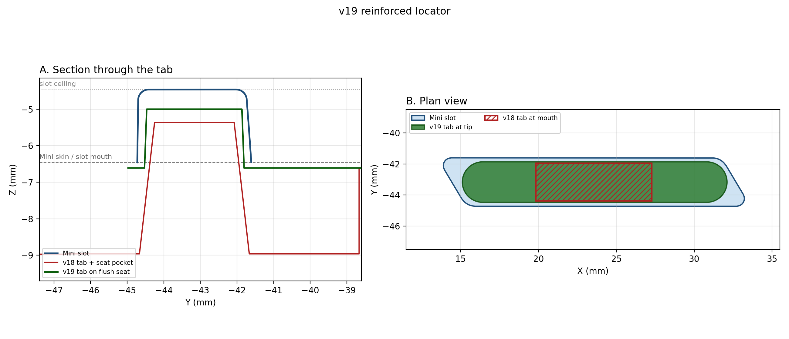
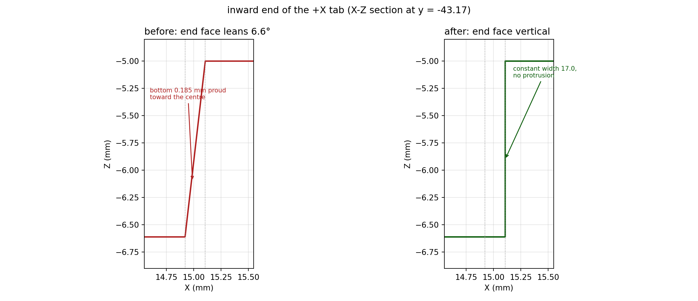
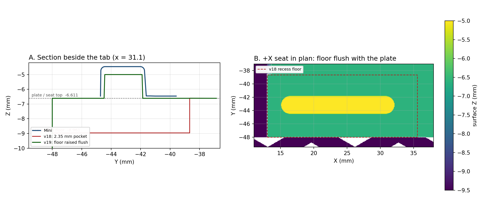
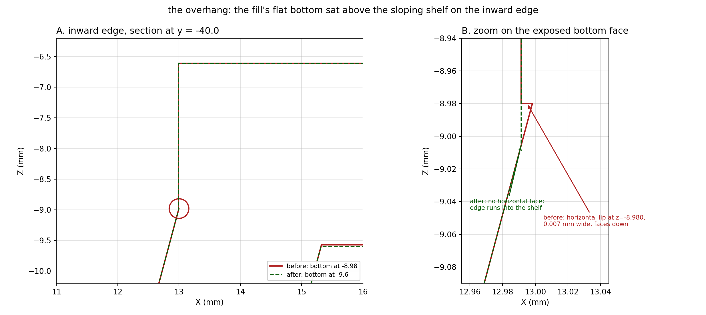

# Reinforced locator tabs (v19)

Status: **implemented in source** (`cad/design_parameters.json` +
`cad/prototype_feedback.py`). Published `export/` files still need a rebuild.

## Problem

The two locating tabs that drop into the Mini's kickstand slots snapped off at the
tips after a few weeks of normal handling (carrying, backpack in/out). The mount is
otherwise sound.

## What changed

The tabs were much smaller than the slot they sit in, shaped like a 13°-per-side
wedge, and rooted at the bottom of a deep seat pocket. All three worked against
them.

| Change | Effect |
| --- | --- |
| Tab now uses 88% of the slot length instead of 40% | 2.46x more load-bearing area |
| 13°/side wedge replaced with a 2.2°/side thickness taper | removes the prying/self-locking action |
| Full-radius (stadium) ends with vertical end faces | keeps the full section and a blunt end at the release gap, with no end-face lean |
| Engagement 1.10 → 1.46 mm (73% of slot depth) | ~33% more bearing height |
| Seat pocket filled flush with the surrounding plate | one step instead of two; unsupported post 2.50 → 0.15 mm |
| Tab root buried 0.1 mm into the plate | volumetric union; no coplanar overhang sliver under the tab ends |

Section at the slot-mouth plane: **2.65x the section modulus**, **2.95x the second
moment**, **2.46x the interlayer bond area**.

## Measured slot geometry

Taken from `docs/official/Starlink_Mini_Dish.stp`. Both slots are identical and
mirrored; figures are for the +X slot, centred at `x = 23.607`, `y = -43.167`.

| Feature | Measurement |
| --- | --- |
| Slot length (X) at the mouth | **19.31 mm** |
| Slot width (Y) at the mouth | **3.12 mm** |
| Slot depth (Z), mouth to ceiling | **2.00 mm** (z = -6.461 → -4.461) |
| Wall taper | ~2.6° per side in Y, ~4.5° per side in X |
| End shape | full radius, ~1.55 mm |
| Slot pitch (left to right) | 47.21 mm |
| Mini bottom skin at the slot mouth | flat, z = -6.461 |

## Why the old tab broke

1. **It was a wedge, not a post.** Thickness fell 3.00 → 2.17 mm over 3.60 mm —
   13° per side — while the slot wall tapers at only 2.6°. At ~13° the taper sits
   close to the self-locking threshold for ASA on ASA, so it could jam and then
   release with a jolt. Each removal ended as a peel load on the thinnest section.
2. **The thin end sat at the slot mouth**, which is where the Mini's hard edge
   clamps the tab: highest stress plus a stress riser on the same plane.
3. **That plane is a layer boundary.** The tabs print pointing up, so the crack ran
   along the weakest plane of an FDM part. ASA has the weakest layer bond of the
   common filaments.
4. **The root was a sharp re-entrant corner** on the pocket floor, 2.50 mm below
   the slot mouth, with only two small end pads.
5. **The tab was a 2.50 mm unsupported post.** The seat floor is 2.50 mm below the
   Mini's skin, so the tab was cantilevered before the slot even gripped it.

Static stress was never the issue — a 50 N lateral load at the engaged tip is only
about 7 MPa at the mouth plane — so this is fatigue plus a layer-plane crack.

## Final geometry

| Parameter | v18 | v19 |
| --- | --- | --- |
| `locator_center_x_mm` | 23.5533 | **23.607** |
| `locator_center_y_mm` | -43.1653 | **-43.1667** |
| `locator_height_mm` | 3.60 | **3.96** (top z = -5.00) |
| `locator_seat_top_z_mm` | — (pocket at -8.96) | **-6.6106** (flush with the plate) |
| `locator_root_embed_mm` | — | **0.1** (buried in the plate) |
| `locator_base_width_mm` (X) | 7.68 | **17.00** |
| `locator_base_thickness_mm` (Y) | 3.00 | **2.72** |
| `locator_tip_width_mm` (X) | 7.349 | **17.00** |
| `locator_tip_thickness_mm` (Y) | 2.172 | **2.60** |
| X taper | 13.0°/side | **none — vertical end faces** |
| Y taper | 13.0°/side | **2.2°/side** |
| End shape | square corners | **full radius (stadium)** |
| Seat | 24 x 9 pocket, 2.35 mm deep | **cut only down to the plate level** |

The tab is 1.61 mm tall above the seat and starts 0.15 mm below the Mini's skin,
so the seat and the surrounding plate are one continuous surface.

The width is constant at 17.0 mm. An earlier 17.37 → 17.00 width taper leaned
each end face outward by 6.6° and left the bottom 0.185 mm proud toward the
release gap; in the 3D viewer that reads as an overhang on the inward end. The
thickness still tapers 2.72 → 2.60 mm (2.2°/side), which is what gives the
trouble-free insertion.

Derived at the slot-mouth plane (z = -6.4606):

| Quantity | v18 | v19 | Change |
| --- | --- | --- | --- |
| Length x thickness | 7.45 x 2.43 mm | 17.00 x 2.71 mm | |
| Cross-section area | 18.07 mm² | 44.48 mm² | **2.46x** |
| Second moment (about X) | 8.86 mm⁴ | 26.32 mm⁴ | **2.95x** |
| Section modulus | 7.30 mm³ | 19.43 mm³ | **2.65x** |
| Interlayer bond area | 18.07 mm² | 44.48 mm² | **2.46x** |

### Fit

| Station | Tab | Slot | Side gap | End gap |
| --- | --- | --- | --- | --- |
| z = -6.45 (mouth) | 17.00 x 2.71 | 19.33 x 3.12 | 0.206 | 1.16 |
| z = -6.20 | 17.00 x 2.69 | 19.29 x 3.10 | 0.204 | 1.14 |
| z = -5.95 | 17.00 x 2.67 | 19.25 x 3.07 | 0.202 | 1.13 |
| z = -5.70 | 17.00 x 2.65 | 19.21 x 3.05 | 0.200 | 1.11 |
| z = -5.20 | 17.00 x 2.61 | 19.13 x 3.01 | 0.196 | 1.07 |

- Exact boolean of the tab against `Starlink_Mini_Dish.stp`: **0.000 mm³ overlap**
  at both locators.
- Seat clearance to the Mini's skin: **0.15 mm**. The measured recess floor
  (22.6 x 9.3 mm, outboard of the nominal 24 x 9 box) was ray-cast against the
  official mesh; the lowest Mini surface is -6.461 everywhere over it, so the
  flush floor at -6.6106 clears.
- Ceiling clearance 0.54 mm; engagement 1.46 mm; tab height above the seat
  1.61 mm.

### Alignment trade-off

The long tab is less forgiving in yaw than the old stub, measured by rotating the
tab section inside the real slot slices:

| Profile | Yaw tolerance |
| --- | --- |
| v18, 7.45 x 2.43 mm | 5.35° |
| v19, 17.00 mm stadium | 1.21° |

That is not the constraint that matters in practice: the retained perimeter rim
fits the Mini at 0.1 mm and dominates alignment long before the tab corner does.

Tapered tab ends were tried and dropped. They raise yaw tolerance to ~1.95° but
cost about 9% of the engaged section, and the end facing the release gap becomes
a wedge for the Mini's slot edge to pry against. Full-radius ends keep the whole
section and give a blunt face where the release push happens.

## Implementation

`cad/prototype_feedback.py` — `tapered_locator()` is a single ruled loft between
two `slot2D` stadium sections of the same 17.0 mm width, from
`locator_seat_top_z_mm` to the tab tip; only the thickness tapers (2.72 → 2.60).
Constant width is what keeps the end faces vertical. The root starts
`locator_root_embed_mm` (0.1 mm) below the seat, so it overlaps the plate instead
of only touching it: a coplanar union leaves a thin downward-facing sliver under
the outboard end of each tab, which reads as an overhang in the slicer and on the
printed part.

`locator_seat_tools()` cuts the seat only down to `locator_seat_top_z_mm`, so the
locator area is flush with the surrounding plate. The release profile and the rear
wall tools use the same level, which removes the old 2.35 mm pocket and its rear
channel.

Other touched files:

| File | Change |
| --- | --- |
| `cad/design_parameters.json` | revision v19, new locator parameters (including `locator_root_embed_mm`), old root-support keys removed |
| `cad/build_design.py`, `cad/generate_mount.py`, `cad/validate_corner_fit.py` | accept the new `locator_profile` value |
| `cad/locator_release_profile.py` | seat and rear-wall cuts stop at the flush seat level |
| `cad/access_feedback.py` | nub cap follows the tab footprint |
| `cad/validate_prototype_feedback.py` | flush-seat / section checks replace the old corner-pad checks |
| `cad/validate_mount.py`, `cad/export_mount_step.py` | v19 added to the revision gates |
| `README.md` | ASA + PLA+ profiles, material table, tab print notes |

### Rebuild prerequisites

A full rebuild needs two assets that are outside version control:

- `docs/example-mount/exterior.stl` (retained mating reference) — not in this
  checkout;
- `cad/review/dish_step_precise_primary.stl` — regenerate with
  `python cad/prepare_step_reference.py`.

Until then, `cad/out/mount_v19.stl` is a
watertight stopgap produced by replacing only the locator region of the published
v18 mesh. It is one connected solid with 0 mm³ interference against the official
dish, but it is **not** a substitute for a proper `export/` rebuild.

The patch raises the recess floor to the *measured* outline, not the nominal
24 x 9 box. The real floor is 22.6 mm wide (x ≈ 13.0 → 35.6) and 9.3 mm deep
(y ≈ -48.0 → -38.7), centred outboard of the tab: the nominal box overhangs the
inboard edge by 1.4 mm and leaves a trench at the front. The measured outline
meets the shelf edges exactly. Diffing v18 against v19 over the whole locator
area shows material added only inside x[13.0, 35.5], y[-48.0, -38.6] (mirrored),
and nothing raised outside the recess.

The fill prism runs down to z = -9.6, below the sloping shelf on the inward
edge. With its bottom at the old floor level (-8.98) the bottom face was exposed
over the finger-pull slope as a 0.007 mm downward lip along x = ±13.0 — the
slight overhang on the inward edge. Burying the bottom removes every downward
face in the locator area.

## Print settings

The geometry does most of the work; the layer bond still needs the right profile.

### ASA (vehicle / outdoor)

| Setting | v18 README | v19 |
| --- | --- | --- |
| Nozzle | 260 °C | **265 °C** |
| Bed (textured PEI) | 100 °C | 100 °C |
| Layer height | 0.2 mm | 0.2 mm |
| Wall loops | 5 | **6** |
| Top / bottom shells | 6 / 6 | 6 / 6 |
| Sparse infill | 25% gyroid | **40% gyroid** |
| Fan min / max | 10% / 30% | **0% / 10%** |
| Flow ratio | 0.95 | **0.97** |
| Seam position | default | **Back, away from the tabs** |
| Chamber | — | **enclosed, 45-50 °C** |

### PLA+ (desk / indoor / backpack)

| Setting | Value |
| --- | --- |
| Nozzle | **225 °C** |
| Bed | 60 °C |
| Layer height | 0.2 mm |
| Wall loops | **6** |
| Top / bottom shells | 6 / 6 |
| Sparse infill | **40% gyroid** |
| Fan min / max | **0% / 40%** |
| Flow ratio | 0.99 |
| Max volumetric speed | 14 mm³/s |
| Outer / inner / sparse | 60 / 100 / 120 mm/s |
| Seam position | **Back** |

- PLA+ softens around 55-60 °C; do not leave a PLA+ mount in a hot vehicle.
- PLA+ has poor UV resistance and will embrittle outdoors.
- PETG is a reasonable middle ground: tougher than PLA+, more heat tolerant, more
  flexible.

## Test plan

1. Print v19 in ASA and PLA+ with the settings above.
2. Caliper the tab at the mouth plane: 17.00 x 2.71 mm ±0.15. If it is over,
   trim `locator_base_thickness_mm` / `locator_tip_thickness_mm` by the
   overshoot rather than sanding.
3. Seat the Mini 20 times; check for scuffing and tight spots.
4. Static: mount upside down with the Mini installed, hang 5 kg from the Mini for
   1 hour. No cracking or whitening at the root.
5. Cycle: 200 lift/place cycles plus 20 minutes of backpack shaking. Inspect the
   tabs under light for crazing at the mouth plane.
6. Long term: the original failed in "a few weeks"; run the new part at least
   8 weeks of the same handling before calling it fixed.

Success: no visible crazing or crack at the slot-mouth plane after the cycle
test, and no rattle in the slot.

## Open items

- Regenerate `export/` once the reference assets are back, then re-run
  `validate_mount.py` and `validate_prototype_feedback.py`.
- Confirm the release push between the tabs still feels right now that the
  surrounding seat is flush.
